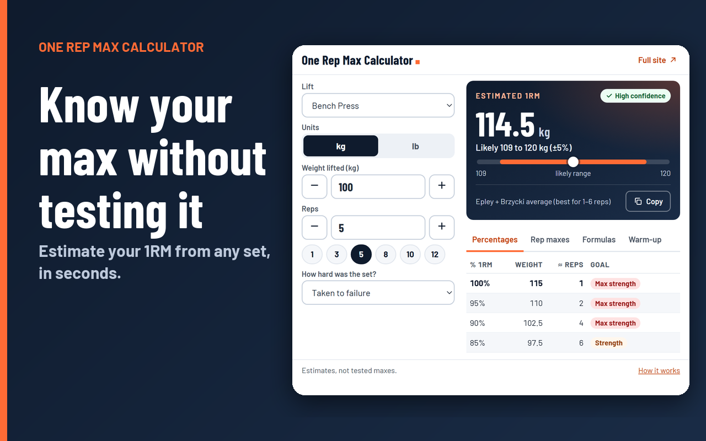
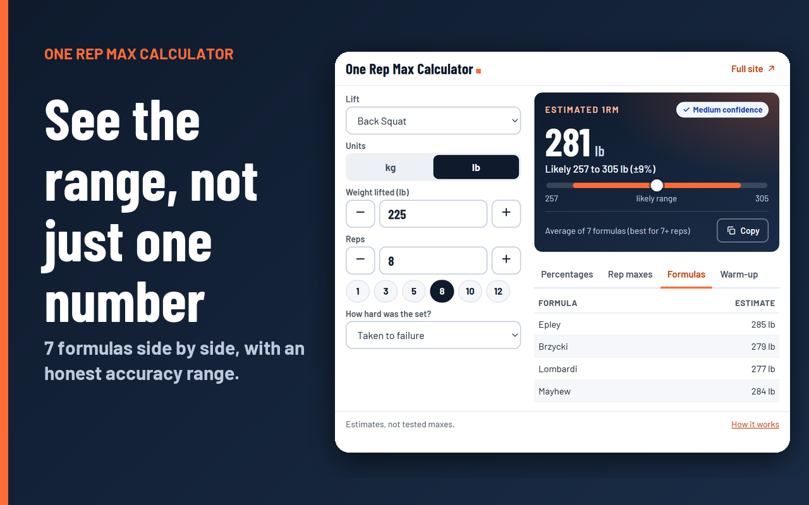
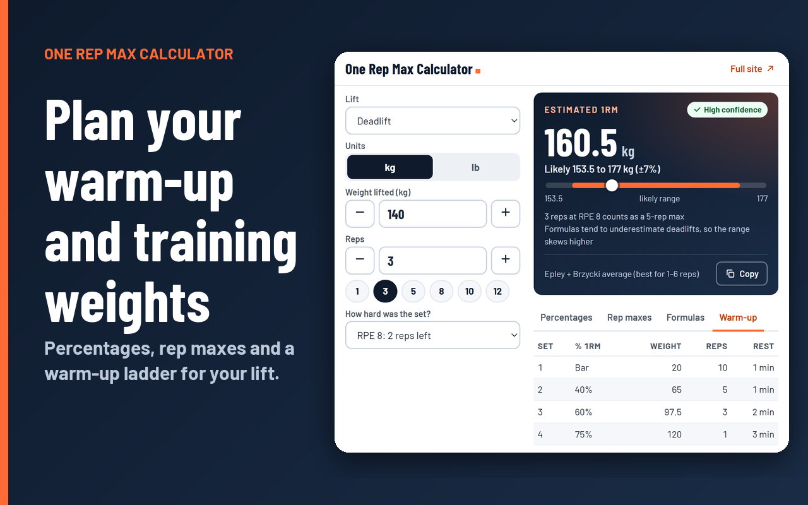

# One Rep Max Calculator: Chrome Extension

Estimate your one rep max (1RM) from any set you have already done, right from your browser toolbar. No account, no ads, no tracking, and it works offline.

This is the companion extension for **[repmaxcalculator.one](https://repmaxcalculator.one/)**. It uses the same calculation engine as the website, so the numbers match.



## What it does

Pick your lift, enter the weight and reps, and get an estimated max with an honest accuracy range, not one falsely precise number.

- **Estimated 1RM** with a likely range and a confidence level
- **7 formulas** side by side: Epley, Brzycki, Lombardi, Mayhew, O'Conner, Wathan and Lander, with the best method chosen for your rep count
- **Percentage table** for strength, muscle size or endurance work
- **Rep-max table** from 1 to 12 reps
- **Warm-up ladder** and meet-attempt suggestions
- **RPE input**, so sets that stopped short of failure still give a useful estimate
- **28 lifts**: barbell, dumbbell, machine and bodyweight, with sled weight, per-dumbbell weight and added-weight handling built in
- **kg and lb**, and a one-click **Copy** of your result

| Estimate and range | Formulas side by side | Warm-up ladder |
|---|---|---|
|  |  |  |

## Install

**From the Chrome Web Store:** listing coming soon.

**From source (developer mode):**

1. Download or clone this repository.
2. Open `chrome://extensions` in Chrome.
3. Turn on **Developer mode** (top right).
4. Click **Load unpacked** and choose the `dist` folder.
5. Pin the extension from the puzzle-piece menu, then click its icon.

## Privacy

- Everything is calculated on your device.
- The extension asks for **no browser permissions** and makes **no network requests**.
- It saves your last inputs (lift, weight, reps) only in your browser's local storage so they are there next time.
- The links inside the popup open [repmaxcalculator.one](https://repmaxcalculator.one/) in a new tab.

Full policy: [repmaxcalculator.one/privacy-policy](https://repmaxcalculator.one/privacy-policy/)

## Learn more on repmaxcalculator.one

### Calculators

| Calculator | Link |
|---|---|
| One rep max calculator (any lift) | [repmaxcalculator.one](https://repmaxcalculator.one/) |
| Bench press 1RM | [/bench-press-1rm-calculator/](https://repmaxcalculator.one/bench-press-1rm-calculator/) |
| Squat 1RM | [/squat-1rm-calculator/](https://repmaxcalculator.one/squat-1rm-calculator/) |
| Deadlift 1RM | [/deadlift-1rm-calculator/](https://repmaxcalculator.one/deadlift-1rm-calculator/) |
| Overhead press 1RM | [/overhead-press-1rm-calculator/](https://repmaxcalculator.one/overhead-press-1rm-calculator/) |
| Incline bench 1RM | [/incline-bench-1rm-calculator/](https://repmaxcalculator.one/incline-bench-1rm-calculator/) |
| Dumbbell bench 1RM | [/dumbbell-bench-1rm-calculator/](https://repmaxcalculator.one/dumbbell-bench-1rm-calculator/) |
| Leg press 1RM | [/leg-press-1rm-calculator/](https://repmaxcalculator.one/leg-press-1rm-calculator/) |
| Weighted pull-up and dip 1RM | [/pull-up-1rm-calculator/](https://repmaxcalculator.one/pull-up-1rm-calculator/) |
| Rep max calculator (3RM, 5RM, 10RM to 1RM) | [/rep-max-calculator/](https://repmaxcalculator.one/rep-max-calculator/) |
| RPE 1RM calculator | [/rpe-1rm-calculator/](https://repmaxcalculator.one/rpe-1rm-calculator/) |
| 1RM warm-up calculator | [/1rm-warm-up-calculator/](https://repmaxcalculator.one/1rm-warm-up-calculator/) |
| 5/3/1 calculator | [/531-calculator/](https://repmaxcalculator.one/531-calculator/) |
| Plate calculator | [/plate-calculator/](https://repmaxcalculator.one/plate-calculator/) |
| DOTS and Wilks calculator | [/dots-wilks-calculator/](https://repmaxcalculator.one/dots-wilks-calculator/) |
| Dumbbell to barbell converter | [/dumbbell-to-barbell-calculator/](https://repmaxcalculator.one/dumbbell-to-barbell-calculator/) |

### Charts and standards

- [One rep max chart (percentage table)](https://repmaxcalculator.one/one-rep-max-chart/)
- [Bench press max chart](https://repmaxcalculator.one/bench-press-max-chart/)
- [Squat and deadlift max charts](https://repmaxcalculator.one/squat-deadlift-max-chart/)
- [Strength standards](https://repmaxcalculator.one/strength-standards/)
- [Average bench press](https://repmaxcalculator.one/average-bench-press/)
- [Average squat and deadlift](https://repmaxcalculator.one/average-squat-deadlift/)

### Guides

- [What is a one rep max?](https://repmaxcalculator.one/what-is-one-rep-max/)
- [How to calculate your one rep max](https://repmaxcalculator.one/how-to-calculate-one-rep-max/)
- [One rep max formulas compared](https://repmaxcalculator.one/one-rep-max-formula/)
- [Are 1RM calculators accurate?](https://repmaxcalculator.one/are-1rm-calculators-accurate/)
- [How to test your 1 rep max safely](https://repmaxcalculator.one/how-to-test-1-rep-max/)
- [What percentage of your 1RM should you lift?](https://repmaxcalculator.one/percentage-of-1rm-to-lift/)
- [Hypertrophy rep range](https://repmaxcalculator.one/hypertrophy-rep-range/)

### About the site

- [About](https://repmaxcalculator.one/about/)
- [Methodology: how the numbers are calculated](https://repmaxcalculator.one/methodology/)
- [Contact](https://repmaxcalculator.one/contact/)
- [Privacy policy](https://repmaxcalculator.one/privacy-policy/)

## How accurate is it?

Estimates are not tested maxes. They are most reliable from hard sets of 2 to 6 reps, and the likely range widens as the set gets longer. The popup shows that range and a confidence label for every result. See the [methodology](https://repmaxcalculator.one/methodology/) and [accuracy guide](https://repmaxcalculator.one/are-1rm-calculators-accurate/) for the details.

This extension is for general information, not medical advice. Use safety equipment or a spotter for heavy lifts, and speak to a doctor before starting a new training program if you have a health condition.

## Project structure

```
extension/
├── dist/                 # The extension itself (load this folder, or zip it)
│   ├── manifest.json     # Manifest V3, no permissions
│   ├── popup.html/.css/.js
│   ├── engine.js         # Calculation engine, same as repmaxcalculator.one
│   ├── data.js           # Lift definitions
│   ├── fonts/            # Barlow and Barlow Condensed (SIL OFL 1.1)
│   └── icons/
├── store/                # Chrome Web Store screenshots and promo images
├── STORE-LISTING.md      # Listing copy and privacy answers for the store
└── README.md
```

### Build a package

The extension has no build step. To make the upload file, zip the contents of `dist/` so that `manifest.json` is at the top level of the archive.

## Credits and licenses

- Calculation formulas: Epley (1985), Brzycki (1993), Lombardi (1989), Mayhew et al. (1992), O'Conner et al. (1989), Wathan (1994) and Lander (1985). Details on the [formulas page](https://repmaxcalculator.one/one-rep-max-formula/).
- Fonts: Barlow and Barlow Condensed, copyright The Barlow Project Authors, licensed under the SIL Open Font License 1.1 (see `dist/fonts/OFL.txt`).
- Extension code and artwork: © [repmaxcalculator.one](https://repmaxcalculator.one/). Add a `LICENSE` file to this repository to state the license you want to use.
